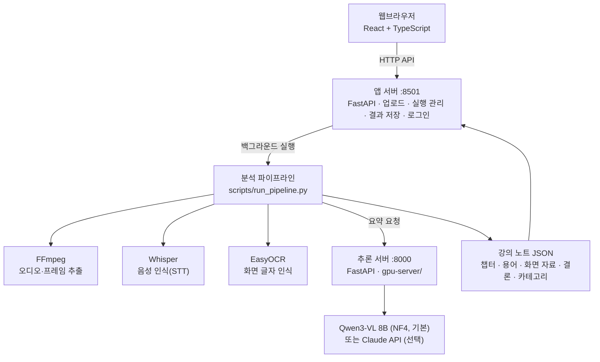

# 핵심만PLZ

**멀티모달 AI 기반 강의 영상 요약 · 강의 노트 생성 시스템** (Multimodal Lecture Video Summarization)

긴 강의 영상은 필요한 부분을 다시 찾기 어렵고, 음성만 받아 적어서는 슬라이드·판서 내용이 빠집니다. 핵심만PLZ는 영상의 **음성(STT)** 과 **화면(OCR·VLM)** 을 함께 분석해, 챕터별 타임라인이 붙은 강의 노트를 만들어 줍니다. 노트의 시간 뱃지를 누르면 영상이 그 지점으로 이동합니다.

모든 분석은 RTX 4090 서버 PC 한 대에서 로컬 모델(Qwen3-VL 8B)로 처리하며, 다른 PC·스마트폰은 웹브라우저로 접속만 합니다.

<!-- TODO: 실제 화면 캡처를 assets/screenshots/ 에 넣은 뒤 아래 주석을 풀어 주세요.
## 화면

| 영상 입력 | 분석 진행 |
| --- | --- |
|  |  |

| 강의 노트 | 노트 라이브러리 |
| --- | --- |
|  |  |
-->

## 주요 기능

- **영상 입력**: 영상 파일(MP4/MOV/AVI) 업로드 또는 유튜브 링크
- **강의 노트 생성**: 제목, 핵심 내용, 주요 용어, 챕터별 요약, 화면 자료(표·그래프·수식·코드·도식·판서), 강조 사항, 공지 사항, 결론
- **챕터 타임라인**: 챕터와 화면 자료의 시간 뱃지를 누르면 영상이 해당 위치로 이동
- **진행 상황 표시**: 7단계 분석 진행률을 실시간으로 표시하고, 실패하면 어느 단계에서 멈췄는지 표시
- **노트 라이브러리**: 완성된 노트를 영상과 함께 저장하고 다시 열기·인쇄·삭제
- **카테고리 분류**: 노트를 과학·공학, 의학·건강, 역사·인문, 시사·사회, 문화·엔터테인먼트, 기타로 자동 분류
- **요약 방식 선택**: 빠르게 / 표준 / 꼼꼼하게 — 음성 인식 모델 크기(Whisper small / medium / large)만 달라지고 분석 단계는 같습니다
- **개발자 화면**: 분석 방식(로컬 모델 / Claude API)·모델 선택, 실행 이력과 단계별 소요 시간, 분석 로그 확인 (개발자 비밀번호 필요)
- **외부 접속(선택)**: 비밀번호 로그인과 Cloudflare Tunnel

## 시스템 구조



앱 서버와 추론 서버는 같은 PC에서 도는 별개의 프로세스이며, 외부에 공개되는 것은 앱 서버(8501) 하나뿐입니다.

분석은 다음 7단계로 진행됩니다.

| 단계 | 내용 | 사용 기술 |
| --- | --- | --- |
| 1 | 오디오 추출 | FFmpeg |
| 2 | 음성 인식(STT) | Whisper |
| 3 | 대본 요약, 중요 구간 추출 | Qwen3-VL 8B |
| 4 | 중요 구간의 대표 프레임 추출 | FFmpeg, OpenCV |
| 5 | 프레임 글자 인식(OCR) | EasyOCR |
| 6 | 프레임 내용 요약(VLM) | Qwen3-VL 8B |
| 7 | 최종 통합 요약, 강의 노트 생성 | Qwen3-VL 8B |

## 기술 스택

| 구분 | 사용 기술 |
| --- | --- |
| 화면 | React, TypeScript, Vite |
| 앱 서버 | Python 3.11, FastAPI, Uvicorn |
| 전처리 | FFmpeg, OpenCV, yt-dlp |
| 음성·화면 인식 | Whisper, EasyOCR |
| 요약 모델 | Qwen3-VL-8B-Instruct (NF4 4비트, 기본) / Claude API (선택) |
| AI 프레임워크 | PyTorch (CUDA), Transformers |
| 실행 환경 | Windows 11, RTX 4090 24GB, conda |
| 외부 접속 | Cloudflare Tunnel |

## 기술적 성과

### 1. Attention 메모리 사용량 절감

Windows용 PyTorch에서는 Qwen3-VL의 GQA attention이 메모리 효율 커널을 쓰지 못하고 Math 커널로 떨어져, 메모리가 입력 길이의 제곱으로 늘었습니다. K/V를 query head 수만큼 복제해 메모리 효율 커널을 쓰도록 한 `sdpa_no_gqa` attention을 구현해 해결했습니다.

| 입력 길이 | 개선 전 (기본 SDPA) | 개선 후 (`sdpa_no_gqa`) |
| --- | --- | --- |
| 7,000 토큰 | 21.0 GB | 7.6 GB |
| 8,000 토큰 | 메모리 부족(OOM) | — |
| 16,000 토큰 | — | 9.8 GB |
| 입력 상한 | 7,000 토큰 | 16,384 토큰 |

RTX 4090 기준. 구현은 [gpu-server/models/attention.py](gpu-server/models/attention.py), 설명은 [gpu-server/models/README.md](gpu-server/models/README.md), 재현 스크립트는 [gpu-server/benchmarks/qwen3vl_context_bench.py](gpu-server/benchmarks/qwen3vl_context_bench.py)에 있습니다.

### 2. 입력 상한을 넘는 긴 강의 처리

대본이 모델 입력 상한(16,384 토큰)을 넘으면 구간별로 나눠 요약한 뒤 하나로 통합합니다. 73분 강의(대본 약 26,859 토큰)는 구간 분할 전에는 입력 초과로 실패했고, 적용 후 세 번의 측정에서 모두 완료됐습니다.

| 측정 | 결과 | 소요 시간 | 최대 예약 VRAM |
| --- | --- | --- | --- |
| 구간 분할 전 | 실패 (입력 상한 초과) | — | — |
| 구간 분할 후 (3회) | 완료 | 361 ~ 398초 | 8.4 ~ 9.1 GiB |

이 수치는 준비된 대본으로 추론 서버의 대본 요약·중요 구간 추출 단계(3단계)만 잰 것으로(2026-10-26), 음성 인식·OCR·프레임 요약 시간은 들어 있지 않습니다. 원본 기록은 [gpu-server/benchmarks/results/](gpu-server/benchmarks/results/)에 있습니다.

### 3. 단일 멀티모달 모델로 단순화

초기에는 요약용 LLM(Qwen3-8B)과 화면 분석용 VLM(Qwen2.5-VL-7B)을 FP16으로 단계마다 올리고 내렸습니다. 지금은 NF4 4비트 Qwen3-VL 8B 하나가 대본 요약·프레임 분석·최종 통합을 모두 맡고, 한 번 올린 모델을 작업 안에서 계속 재사용합니다.

### 전체 처리 시간 (참고)

영상 입력부터 강의 노트 완성까지 걸린 시간입니다. 서버 PC의 실행 이력에서 가져온 값으로, 영상마다 한 번씩 실행한 결과이며 원본 기록은 저장소에 포함되지 않습니다(표준 설정, Whisper medium, Qwen3-VL 8B).

| 영상 길이 | 분석한 프레임 | 전체 소요 시간 |
| --- | --- | --- |
| 56분 | 46장 | 약 9분 |
| 107분 | 281장 | 약 46분 |
| 184분 | 423장 | 약 75분 |

소요 시간은 영상 길이보다 중요 구간에서 뽑은 프레임 수에 크게 좌우됩니다(184분 영상은 전체 시간의 절반가량이 프레임 요약 단계).

## 빠른 실행

Windows 11과 NVIDIA GPU(RTX 4090 24GB에서 개발·확인)를 기준으로 합니다.

**1. 사전 준비**

- [FFmpeg](https://ffmpeg.org/) — `ffmpeg`, `ffprobe`가 PATH에서 실행되어야 합니다
- [Node.js LTS](https://nodejs.org/) — React 화면 빌드용
- Anaconda 또는 Miniconda

**2. 앱 환경** (`capstone`)

```bash
git clone https://github.com/JBKernix/Capstone_video-summarization.git
cd Capstone_video-summarization
conda create -n capstone python=3.11
conda activate capstone
pip install -r requirements.txt
```

**3. 추론 서버 환경** (`video_summarization`)과 기본 모델 다운로드 (약 18GB)

```bash
conda create -n video_summarization python=3.11
conda activate video_summarization
cd gpu-server
pip install -r requirements.txt
pip install -r requirements-local.txt
python scripts/download_models.py --model qwen3-vl-8b
cd ..
```

**4. 실행**

```bat
start_all.bat
```

추론 서버(8000)와 앱 서버(8501)를 차례로 띄우고, React 화면이 빌드되어 있지 않으면 먼저 빌드합니다. 브라우저에서 `http://127.0.0.1:8501`로 접속합니다.

| 명령 | 동작 |
| --- | --- |
| `start_all.bat` | 추론 서버 + 앱 서버 실행 |
| `start_all.bat -Tunnel` | 위 + Cloudflare Tunnel로 외부 접속 주소 발급 |
| `restart_servers.bat` | 두 서버만 재시작 (터널 주소는 유지) |
| `stop_all.bat` | 모두 종료 |

`start_all`은 conda 환경이 `%USERPROFILE%\anaconda3\envs\` 아래에 있다고 가정합니다. 위치가 다르면 `APP_PYTHON`, `SERVER_PYTHON` 환경변수로 각 `python.exe` 경로를 지정하세요.

> **외부에 공개하기 전에** 개발자 화면 비밀번호(`DEV_PASSWORD`, 기본값 `admin`)를 반드시 바꾸고, 입장 비밀번호(`APP_PASSWORD`)를 설정하세요. 설정하지 않으면 주소를 아는 누구나 로그인 없이 사용할 수 있습니다.

자세한 설치·운영 방법은 [단일 서버 운영 가이드](docs/single_server_deployment.md)와 [설치 및 실행 가이드](docs/setup_guide.md)를, Claude API 사용은 [분석 방식 설정](docs/analysis_backends.md)을 참고하세요. 웹 화면 없이 명령줄로 실행하는 방법은 [CLI 스크립트 설명](docs/explanation/scripts/scripts.md)에 있습니다.

## 폴더 구조

```text
Capstone_video-summarization/
├── frontend/      # React 화면 (사용자용 · 개발자용)
├── app/           # 앱 서버 (app/api, FastAPI) · 예비 Streamlit 화면
├── modules/       # 전처리, STT, OCR, 요약 클라이언트, 강의 노트·카테고리 규칙
├── scripts/       # 파이프라인 실행 스크립트 (run_pipeline.py 등)
├── gpu-server/    # LLM/VLM 추론 서버, 모델 로더, 벤치마크
├── configs/       # STT 등 설정
├── docs/          # 설치·운영·데이터 형식·모듈별 설명 문서
├── tests/         # 앱 테스트 (추론 서버 테스트는 gpu-server/tests)
├── assets/        # 실행 파일 아이콘
└── start_all.bat, stop_all.bat, restart_servers.bat, start_tunnel.bat
```

## 구현 및 검증 상태

| 기능 | 구현 | 검증 |
| --- | --- | --- |
| 파일·유튜브 입력 | ✅ | 서버 PC에서 실사용 |
| 7단계 분석 + 진행률 표시 | ✅ | 단위 테스트, 서버 PC에서 실사용 (최장 184분 영상) |
| Qwen3-VL 8B 로컬 추론 | ✅ | 벤치마크 기록 ([results](gpu-server/benchmarks/results/)) |
| 긴 강의 구간 요약 | ✅ | 73분 강의 벤치마크 3회 완료 |
| 강의 노트 · 챕터 타임라인 | ✅ | 단위 테스트 |
| 카테고리 분류 | ✅ | 단위 테스트 |
| 로그인 · 개발자 권한 | ✅ | 단위 테스트 |
| Claude API 분석 | ✅ | 모의 응답 테스트, 실제 호출은 1회만 확인 |
| Cloudflare 외부 접속 | ✅ | 터널 연결 확인, 외부 기기 접속 점검 기록은 없음 |
| Qwen3-VL 외 로컬 모델 5종 | 로더만 | GPU 추론 검증 기록 없음 |
| 영상 기반 질의응답 | ❌ | 초기 목표였으나 미구현 |

### 알려진 한계

- 요약 품질(정확도, 환각 여부)과 음성 인식 오류율을 정량으로 평가하지 않았습니다.
- 한 번에 하나의 영상만 분석하며, 사용자 계정 구분이 없습니다.
- 프롬프트가 강의에 맞춰져 있어 회의·뉴스 등 다른 유형의 영상에서는 결과 형식이 어색할 수 있습니다.
- 프레임이 많은 영상은 프레임 요약 단계 때문에 처리 시간이 길어집니다.

### 향후 계획

영상 기반 질의응답(RAG), 요약 품질 평가 체계, 회의·세미나용 프롬프트, 동시 요청 대기열.

## 팀

| 이름 | 담당 |
| --- | --- |
| 함도연 | STT 데이터, AI 모델 조사, VLM/LLM 환경 설정 |
| 김승민 | 영상 전처리, 프레임/오디오 분할, 입출력 UI |
| 정병두 | OCR 데이터, AI 모델 조사, VLM/LLM 모듈 설계 |
| 조윤호 | 입출력 UI |

## 문서

| 문서 | 내용 |
| --- | --- |
| [단일 서버 운영 가이드](docs/single_server_deployment.md) | `start_all` 동작, 환경변수, Cloudflare Tunnel, 외부 접속 비밀번호 |
| [설치 및 실행 가이드](docs/setup_guide.md) | 환경 준비, 개별 실행, 예비 Streamlit 화면, 문제 해결 |
| [분석 방식 설정](docs/analysis_backends.md) | 로컬 모델 / Claude API 선택 |
| [시스템 개요](docs/system_overvies.md) | 전체 구조와 처리 흐름 |
| [데이터 형식](docs/data_format.md) | 단계별 출력 파일과 강의 노트 JSON 구조 |
| [실행 이력](docs/run_history.md) | 실행별 소요 시간·처리량 기록과 조회 방법 |
| [모듈별 설명](docs/explanation/README.md) | 앱 API, React 화면, 파이프라인, 각 모듈 상세 |
| [추론 서버](gpu-server/README.md) · [로컬 모델 가이드](gpu-server/docs/local_models.md) | 추론 서버 API, 모델 목록과 다운로드 |
| [Notion 기술 문서](https://app.notion.com/p/41aaf0b394da8159a4defcfd92d4b650) | 개발 기록, 기술적 의사결정, 문제 해결, 회고 |
